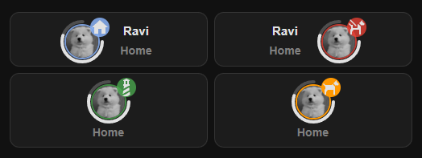

# Modular Person Card



A Home Assistant Lovelace card for showing a `person` or `device_tracker` as a clean compact card with:

- avatar or entity picture
- location badge with smart zone detection
- optional 3/4 progress ring around the avatar
- optional popup with related entities and a live or history map
- custom rules that can change the main icon and badge color

It works well for people, phones, cars, bikes, pets, or any tracker-based entity you want to surface quickly on a dashboard.

## HACS

This repository is prepared for HACS custom repository usage as a `Dashboard` repository.

### Install with HACS custom repositories

1. Open HACS in Home Assistant.
2. Open the menu in the top-right corner.
3. Select `Custom repositories`.
4. Add `https://github.com/Rhaenon/modular-person-card`.
5. Select category `Dashboard`.
6. Install `Modular Person Card`.

HACS should normally register the dashboard resource automatically. If it does not, add this resource manually:

```yaml
- url: /hacsfiles/modular-person-card/modular-person-card.js
  type: module
```

### Install manually

Copy these files into your Home Assistant `www/community/modular-person-entity-card/` folder:

- `modular-person-entity-card.js`
- `modular-person-entity-card-editor.js`
- `modular-person-popup.js`

Then add the resources in Lovelace.

## What This Card Can Do

### Main card

- Supports `person` and `device_tracker`
- Shows the entity picture in a circular avatar
- Shows a badge icon for the current state or zone
- Shows the entity name optionally
- Supports mirrored layout when the name is shown
- Opens a popup when the card is clicked

### Smart location display

- `home` displays as `Home`
- `not_home` can display distance from a proximity entity
- `unknown` and `unavailable` display as `Unknown`
- Any other state is treated like a zone name
- Zone matching works with:
  - `zone.<state>`
  - zone entity id
  - zone friendly name
  - normalized names such as `Work`, `work`, or `work_zone`

### Popup

The popup can include:

- the main tracked entity row
- the proximity entity row
- the find-phone script or button row
- the ring tracker entity row
- the ring boolean helper row
- each custom entity as its own row
- a map card

The popup also has:

- a `History` button that opens Home Assistant more-info on the history view
- a `Settings` button that opens Home Assistant more-info on the settings view
- clickable rows that open more-info for that entity

### Ring tracker

The ring tracker is an optional 3/4 arc around the avatar.

- Uses a numeric entity
- Supports custom minimum and maximum values
- Converts the source value to a 0-100 display range automatically
- Can use a helper boolean entity for active/charging state
- Can also detect charging/active-like states from entity attributes
- Changes color based on value:
  - `<= 10`: red
  - `<= 25`: orange
  - active/charging: green or your custom active color
  - otherwise: normal text color

### Custom entity rules

Custom entities serve two purposes:

- they appear as extra rows in the popup
- they can override the main card icon and badge color when their rule matches

If `interactive_icon: true` and the rule matches, that row can become the main card's active icon/color override.

### Custom colors

You can override badge colors for:

- home
- away
- zone
- unknown
- ring active state

## Installation

### Required resource

```yaml
- url: /local/community/modular-person-entity-card/modular-person-entity-card.js
  type: module
```

### Recommended editor resource

If you want the visual editor in the Lovelace UI, also add:

```yaml
- url: /local/community/modular-person-entity-card/modular-person-entity-card-editor.js
  type: module
```

## Basic Example

```yaml
type: custom:modular-person-entity-card
entity: person.john
show_name: true
```

## Person Example With Distance And Popup Map

```yaml
type: custom:modular-person-entity-card
entity: person.john
proximity_entity: sensor.home_john_distance
findPhoneScriptId: script.find_john_phone
show_name: true
show_history: true
history_hours: 24
```

## Vehicle Example

```yaml
type: custom:modular-person-entity-card
entity: device_tracker.family_car
name: Family Car
show_name: true
custom_location_colors: true
home_icon_background_color: "#4caf50"
away_icon_background_color: "#f44336"
zone_icon_background_color: "#2196f3"
unknown_icon_background_color: "#9e9e9e"
```

## Configuration Reference

| Option | Type | Default | Description |
|---|---|---:|---|
| `entity` | string | required | Main `person` or `device_tracker` entity |
| `name` | string | entity friendly name | Custom label shown on the card |
| `icon` | string | `mdi:map-marker-radius` | Fallback main icon for non-standard states |
| `show_name` | boolean | `true` | Show the entity name on the card |
| `mirror_layout` | boolean | `false` | Reverses avatar/text layout when `show_name` is enabled |
| `proximity_entity` | string | empty | Optional entity used to show distance while away |
| `findPhoneScriptId` | string | empty | Optional script, button, or input button shown in the popup |
| `show_history` | boolean | `true` | Show map track history in the popup |
| `history_hours` | number | `24` | Hours of history shown in the popup map |
| `ring_tracker_enabled` | boolean | auto | Enables the ring tracker |
| `ring_tracker_entity` | string | empty | Numeric entity used for the ring |
| `ring_boolean_entity` | string | empty | Optional helper entity for active/charging state |
| `ring_charging_entity` | string | empty | Legacy fallback for `ring_boolean_entity` |
| `ring_min` | number | `0` | Minimum value for ring normalization |
| `ring_max` | number | `100` | Maximum value for ring normalization |
| `custom_location_colors` | boolean | auto | Enables custom badge/ring color values |
| `home_icon_background_color` | string | `rgb(137,179,248,0.85)` | Home badge color |
| `away_icon_background_color` | string | `rgb(244,67,54,0.75)` | Away badge color |
| `zone_icon_background_color` | string | `rgb(76, 175, 80, 0.75)` | Zone badge color |
| `unknown_icon_background_color` | string | `rgb(160,160,160,0.75)` | Unknown badge color |
| `ring_active_color` | string | `rgb(76, 175, 80, 0.75)` | Active/charging ring color when custom colors are enabled |
| `custom_states` | list | `[]` | Custom entity rows and optional icon/color override rules |

## Ring Tracker

Enable the ring tracker by setting:

```yaml
ring_tracker_enabled: true
ring_tracker_entity: sensor.john_battery
```

### How the ring value is calculated

The card normalizes your ring entity using:

```text
(current - min) / (max - min) * 100
```

So you can use percentages, battery values, steps, tank levels, distances, or any other numeric sensor.

Example with a non-percentage sensor:

```yaml
type: custom:modular-person-entity-card
entity: person.john
ring_tracker_enabled: true
ring_tracker_entity: sensor.john_steps
ring_min: 0
ring_max: 10000
```

### Ring active and charging detection

If `ring_boolean_entity` is set, the ring is treated as active when that entity is:

- `on`
- `charging`
- `true`

The card also checks the tracked entity for common charging attributes like:

- `charging: true`
- `battery_charging: true`
- `status: charging`

### Ring value sources

The card tries these values in order:

- entity state
- `percentage` attribute
- `battery_level` attribute
- `value` attribute

If none are numeric, the ring is hidden.

## Custom Location Colors

Set `custom_location_colors: true` to use your own colors.

Example:

```yaml
type: custom:modular-person-entity-card
entity: person.john
custom_location_colors: true
home_icon_background_color: rgb(137 179 248 / 0.85)
away_icon_background_color: rgba(244, 67, 54, 0.75)
zone_icon_background_color: rgb(76 175 80 / 0.75)
unknown_icon_background_color: rgba(160, 160, 160, 0.75)
ring_active_color: "#00c853"
```

These fields accept normal CSS color values such as:

- `#4caf50`
- `rgba(244, 67, 54, 0.75)`
- `rgb(137 179 248 / 0.85)`
- `orange`

## Popup Behavior

When the main entity has latitude and longitude, the popup shows a Home Assistant map card.

- If `show_history: true`, the map includes a track history overlay
- If `show_history: false`, the map shows only the current location
- If no GPS coordinates are available, the popup shows `Location data not available.`

Example:

```yaml
type: custom:modular-person-entity-card
entity: person.john
show_history: true
history_hours: 12
```

## Custom Entities

Each item in `custom_states` can:

- add an entity row to the popup
- optionally override the main icon and badge color

Structure:

```yaml
custom_states:
  - entity: sensor.example
    state: "on"
    icon: mdi:flash
    color: orange
    interactive_icon: true
```

### Fields

| Field | Type | Description |
|---|---|---|
| `entity` | string | Entity to show in the popup and evaluate |
| `state` | string | Match rule for the entity state |
| `icon` | string | Icon used if this rule becomes active |
| `color` | string | Badge background color used if this rule becomes active |
| `interactive_icon` | boolean | If `true`, this rule may override the main icon/color |

Notes:

- custom rows are only shown once even if referenced multiple times
- rows already used as main entity, proximity, find-phone, or ring entities are not duplicated
- if `interactive_icon` is `false`, the entity still appears in the popup but does not override the main icon

## Rule Syntax

The `state` field supports both exact matches and numeric expressions.

### Exact state matches

```text
on
off
home
charging
```

Boolean values are normalized, so `true` behaves like `on` and `false` behaves like `off`.

### Numeric comparisons

```text
>100
>=50
<10
<=25
=0
==0
!=0
```

### Inclusive ranges

Use three dots:

```text
10...50
```

This matches any number from `10` through `50`, inclusive.

### AND conditions

```text
>=10 && <50
```

### OR conditions

```text
<10 || >50
```

## Full Example

```yaml
type: custom:modular-person-entity-card
entity: device_tracker.family_car
name: Family Car
proximity_entity: sensor.family_car_distance
findPhoneScriptId: script.find_family_car
show_name: true
mirror_layout: false

ring_tracker_enabled: true
ring_tracker_entity: sensor.family_car_battery
ring_boolean_entity: binary_sensor.family_car_charging
ring_min: 0
ring_max: 100

show_history: true
history_hours: 12

custom_location_colors: true
home_icon_background_color: rgb(137 179 248 / 0.85)
away_icon_background_color: rgba(244, 67, 54, 0.75)
zone_icon_background_color: rgb(76 175 80 / 0.75)
unknown_icon_background_color: rgba(160, 160, 160, 0.75)
ring_active_color: "#22c55e"

custom_states:
  - entity: sensor.family_car_speed
    state: "=0"
    icon: mdi:car-brake-parking
    color: gray
    interactive_icon: true
  - entity: sensor.family_car_speed
    state: "1...100"
    icon: mdi:car
    color: "#ff9800"
    interactive_icon: true
  - entity: sensor.family_car_speed
    state: ">100"
    icon: mdi:speedometer
    color: "rgba(244, 67, 54, 0.75)"
    interactive_icon: true
  - entity: binary_sensor.family_car_charging
    state: "on"
    icon: mdi:ev-station
    color: "#22c55e"
    interactive_icon: false
```

## Visual Editor Support

The included editor supports:

- picking a `person` or `device_tracker`
- toggling name visibility
- mirroring the layout
- selecting proximity and find-phone entities
- enabling and configuring the ring tracker
- enabling map history and history hours
- setting custom colors
- adding and removing custom entities

## Tips

- Use a `proximity_entity` if you want `not_home` to show distance instead of just `Away`
- Use `ring_min` and `ring_max` whenever your sensor is not already 0-100
- Use `interactive_icon: true` only for rules that should replace the main icon
- Use `interactive_icon: false` for popup-only helper rows
- Add the editor resource if you want the Lovelace UI editor to work reliably

## Compatibility Notes

- `ring_charging_entity` is still supported as a legacy fallback for `ring_boolean_entity`
- if the main entity has no GPS coordinates, the popup map cannot be shown
- if the ring entity does not expose a numeric value, the ring is not rendered

## Releases

HACS can install from the default branch, but GitHub releases are recommended because HACS will prefer the latest published release when one exists.

Suggested release flow:

1. Update [CHANGELOG.md](CHANGELOG.md).
2. Commit and push to `main`.
3. Create a GitHub release such as `v1.0.0`.
4. Use the same version number consistently in the tag and release title.

If you later want to submit this repository to the default HACS store, the HACS docs currently require:

- a valid custom-repository structure
- passing HACS validation
- at least one published GitHub release
- a public GitHub repository with description and topics
